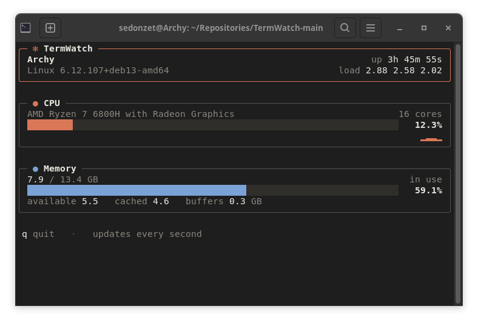

# 🖥️ TermWatch (Underwork)

<p align="center">
  
  
  
  
</p>

<p align="center">
  A lightweight, real-time system monitor and process viewer written in <b>pure C</b>. Monitor system resources, browse running processes, and inspect process information through an interactive, keyboard-driven terminal interface. No third-party libraries, reading live telemetry straight from <code>/proc</code> and POSIX system calls.
</p>

---

<p align="center">
  
</p>

---

## 📋 Table of Contents

- [Overview](#-overview)
- [Features](#-features)
- [Directory Structure](#-directory-structure)
- [Technical Deep Dive](#-technical-deep-dive)
  - [CPU Usage Calculation](#cpu-usage-calculation)
  - [Memory Usage Calculation](#memory-usage-calculation)
  - [Flicker-Free Rendering](#flicker-free-rendering)
- [Prerequisites](#-prerequisites)
- [Build & Run](#-build--run)
- [How It Works](#-how-it-works)
- [Roadmap](#-roadmap)
- [Contributing](#-contributing)

---

## 🔍 Overview

**TermWatch** is a native terminal system monitor designed to provide real-time Linux system statistics and an interactive view of running processes in one place.

Instead of relying on external monitoring commands or a graphical interface, TermWatch collects system information directly from Linux interfaces such as `/proc`, allowing users to monitor CPU and memory usage, navigate processes, and inspect process details without leaving the terminal.

It reads `/proc/cpuinfo`, `/proc/stat`, and `/proc/meminfo`, and uses POSIX calls (`gethostname`, `uname`, `sysinfo`, `getloadavg`) for OS-level metadata. This keeps it fast, dependency-free, and a practical reference for understanding how Linux exposes system telemetry.

The goal is to create a fast, lightweight, and practical Linux utility inspired by tools like `htop`, built from the ground up in C.

---

## ✨ Features

| Category | Detail | Status |
|---|---|---|
| 🖥️ **System Monitoring** | Hostname, OS and kernel release, uptime, and load average | Available |
| ⚙️ **CPU Monitoring** | Processor model, logical core count, live utilization from `/proc/stat`, and a rolling usage history sparkline | Available |
| 🧠 **Memory Monitoring** | Used / total RAM in GB, usage percentage, available, cached, and buffers | Available |
| 📊 **Resource Visualization** | Smooth sub-cell usage bars that shift color as load rises | Available |
| 🔄 **Live Updates** | Statistics refresh every second without flicker | Available |
| 🧹 **Graceful Exit** | `q`, `Ctrl+C`, `SIGTERM`, and `SIGHUP` restore the terminal state | Available |
| 📋 **Process Viewer** | Browse running processes and view PID, process name, CPU usage, and memory usage | Planned |
| 🔎 **Process Search** | Find specific processes by name or PID | Planned |
| ↕️ **Process Sorting** | Sort processes by PID, CPU usage, or memory usage |  Planned |
| ⌨️ **Interactive Navigation** | Navigate the interface and process list using keyboard controls | Planned |
| 🪶 **Lightweight Design** | Native terminal interface written in C, without requiring a graphical desktop | Available |

---

## 📁 Directory Structure

```
TermWatch/
├── Makefile                 Build rules: compile, link, clean
├── README.md
├── usage.png                Screenshot used in this README
├── .gitignore
└── src/
    ├── main.c               Entry point: sampling loop and input handling
    ├── system_info.h/.c     Hostname, OS, kernel, uptime, load average
    ├── cpu_info.h/.c        /proc/cpuinfo and /proc/stat parsing
    ├── mem_info.h/.c        /proc/meminfo parsing
    ├── term.h/.c            Raw mode, alternate screen, signals, frame output
    └── ui.h/.c              Layout, boxes, usage bars, sparkline
```

---

## 🧮 Technical Deep Dive

### CPU Usage Calculation

CPU load isn't directly exposed by the kernel as a percentage. It must be **derived** from cumulative tick counters exposed in `/proc/stat`. The first line of that file looks like:

```
cpu  user nice system idle iowait irq softirq steal guest guest_nice
```

Each value is the total number of clock ticks the CPU has spent in that state **since boot**. Because these are cumulative counters, a single snapshot is meaningless. Usage must be computed as a **delta between two samples** taken one second apart.

**Step 1: Classify tick states**

$$
\text{Idle} = \text{idle} + \text{iowait}
$$

$$
\text{NonIdle} = \text{user} + \text{nice} + \text{system} + \text{irq} + \text{softirq} + \text{steal}
$$

$$
\text{Total} = \text{Idle} + \text{NonIdle}
$$

**Step 2: Take two samples ($t_0$ and $t_1$), one second apart**

$$
\Delta\text{Total} = \text{Total}_{t_1} - \text{Total}_{t_0}
$$

$$
\Delta\text{Idle} = \text{Idle}_{t_1} - \text{Idle}_{t_0}
$$

**Step 3: Compute utilization percentage**

$$
\text{CPU Usage \%} = \left( \frac{\Delta\text{Total} - \Delta\text{Idle}}{\Delta\text{Total}} \right) \times 100
$$

This gives the fraction of CPU time that was **not** spent idling during the sampling window, which is real utilization. TermWatch performs this two-sample delta on every refresh cycle and keeps the recent readings for the history sparkline.

### Memory Usage Calculation

Memory statistics are parsed from key-value pairs in `/proc/meminfo` (values in kB):

```
MemTotal:        16384000 kB
MemFree:          2048000 kB
MemAvailable:     9500000 kB
Buffers:           204800 kB
Cached:           4096000 kB
```

TermWatch uses `MemTotal` and `MemAvailable`, **not** `MemFree`, because `MemAvailable` already accounts for reclaimable caches and buffers, giving a realistic estimate of memory actually available to applications. `Buffers` and `Cached` are shown separately for reference.

**Used memory**

$$
\text{MemUsed} = \text{MemTotal} - \text{MemAvailable}
$$

**Usage percentage**

$$
\text{Memory Usage \%} = \left( \frac{\text{MemUsed}}{\text{MemTotal}} \right) \times 100
$$

**Conversion to GB** (values from `/proc/meminfo` are in kB)

$$
\text{GB} = \frac{\text{kB}}{1024 \times 1024}
$$

### Flicker-Free Rendering

Terminal flicker usually comes from clearing the whole screen and redrawing it piece by piece. TermWatch avoids that:

- It runs on the **alternate screen**, so your shell history is untouched and restored on exit.
- Each frame is built in memory and sent with **a single `write()`**.
- Frames start with the cursor at the top-left and clear only the end of each line, never the full screen.
- Output is wrapped in the **synchronized output** sequence, so supporting terminals show the frame all at once.
- Usage bars use eighth-width block characters for smooth movement between refreshes.

---

## 🛠️ Prerequisites

- A Linux environment (native Linux or **WSL2** on Windows)
- `gcc` (GNU Compiler Collection)
- `make`
- A terminal with UTF-8 and truecolor support (almost all modern terminals)

Install on Debian/Ubuntu if needed:

```bash
sudo apt update
sudo apt install build-essential
```

---

## 🚀 Build & Run

### Option 1: Using `make` (recommended)

```bash
git clone https://github.com/ikkerprasetya/TermWatch.git
cd TermWatch

make
./termwatch
```

Clean build artifacts:

```bash
make clean
```

### Option 2: Direct `gcc` compilation

```bash
gcc -Wall -Wextra -O2 -std=c99 -D_DEFAULT_SOURCE -Isrc src/*.c -o termwatch
./termwatch
```

Press `q` or `Ctrl+C` to exit. The terminal is automatically restored.

---

## ⚙️ How It Works

1. **`main.c`** primes the CPU counters, enters the alternate screen through **`term.c`**, and starts the loop.
2. Each loop iteration renders a frame, then waits for a key press or until the next one-second sample is due.
3. On every sample:
   - **`system_info.c`** fetches hostname, OS name, kernel release, uptime, and load average.
   - **`cpu_info.c`** reads `/proc/stat` and computes the usage delta since the previous sample. Static details (model, core count) are read once from `/proc/cpuinfo`.
   - **`mem_info.c`** parses `/proc/meminfo` for total, available, cached, and buffer memory.
4. **`ui.c`** lays out the header, CPU, and memory panels, then hands the finished frame to `term_present`.
5. Resizing the terminal triggers an immediate redraw, and `q`, `Ctrl+C`, `SIGTERM`, or `SIGHUP` restore the cursor and the normal screen before exit.

---

## 🤝 Contributing

Contributions, issues, and feature requests are welcome!

1. Fork the repository
2. Create your feature branch (`git checkout -b feature/amazing-feature`)
3. Commit your changes (`git commit -m 'Add amazing feature'`)
4. Push to the branch (`git push origin feature/amazing-feature`)
5. Open a Pull Request
